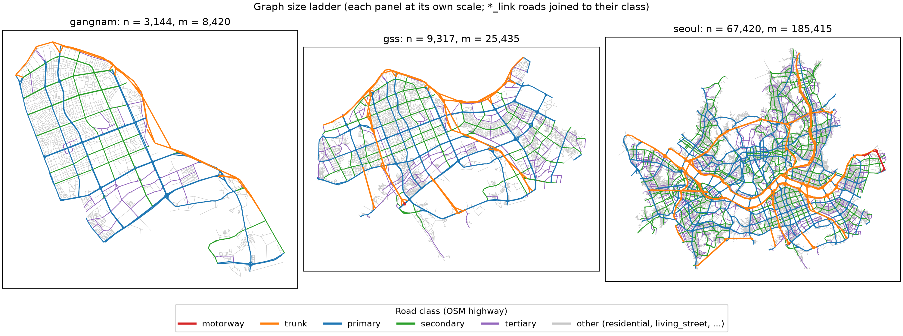
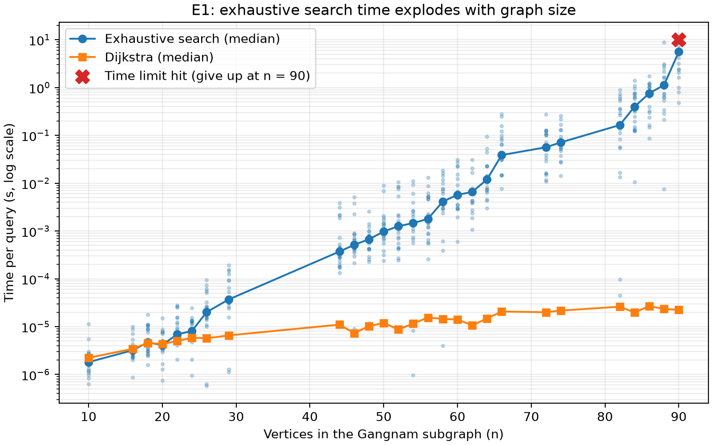
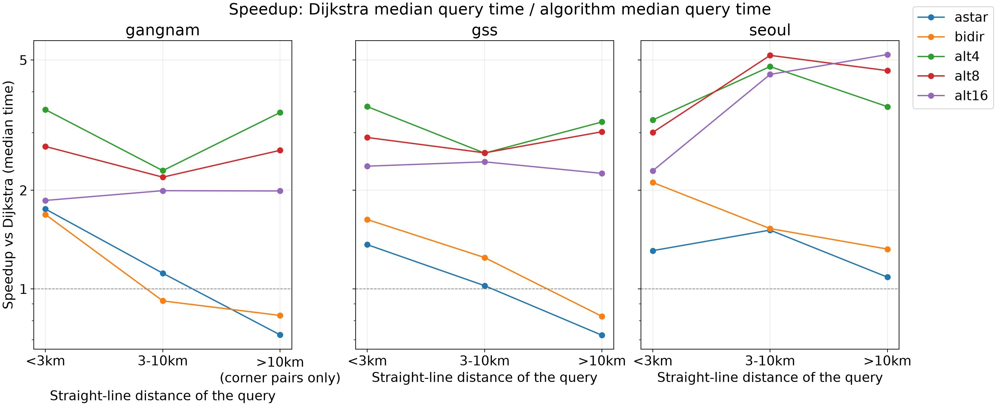
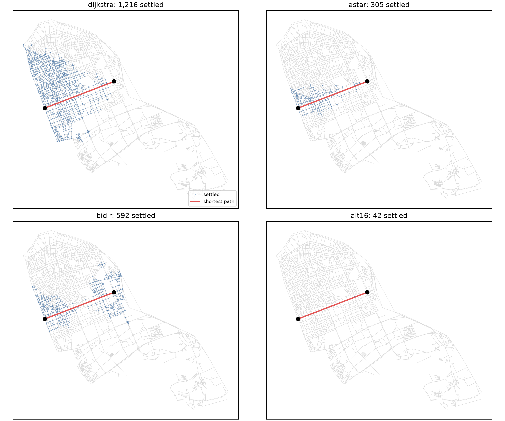
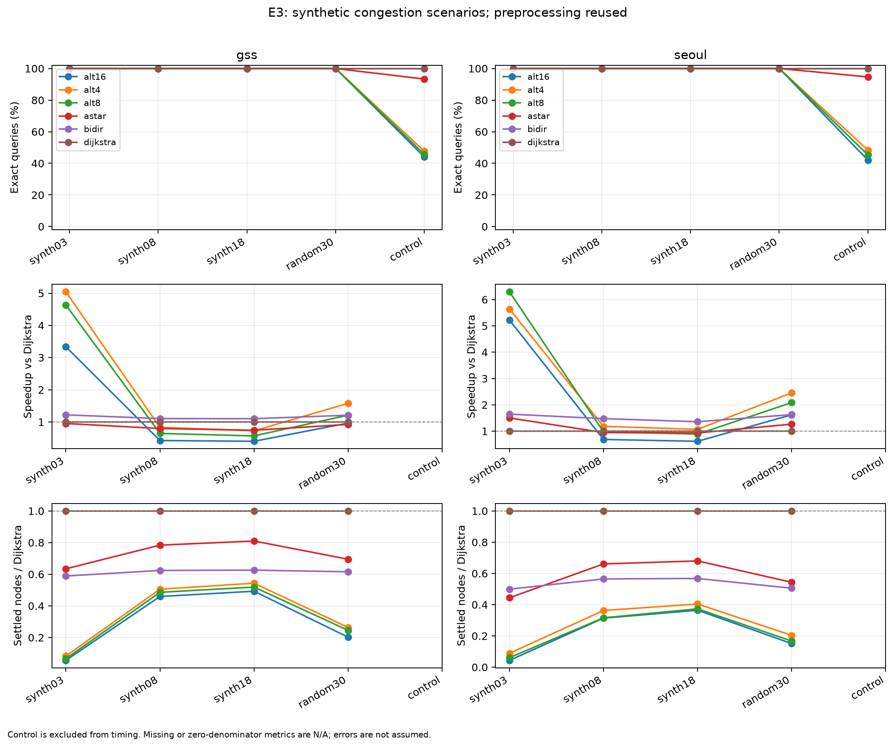
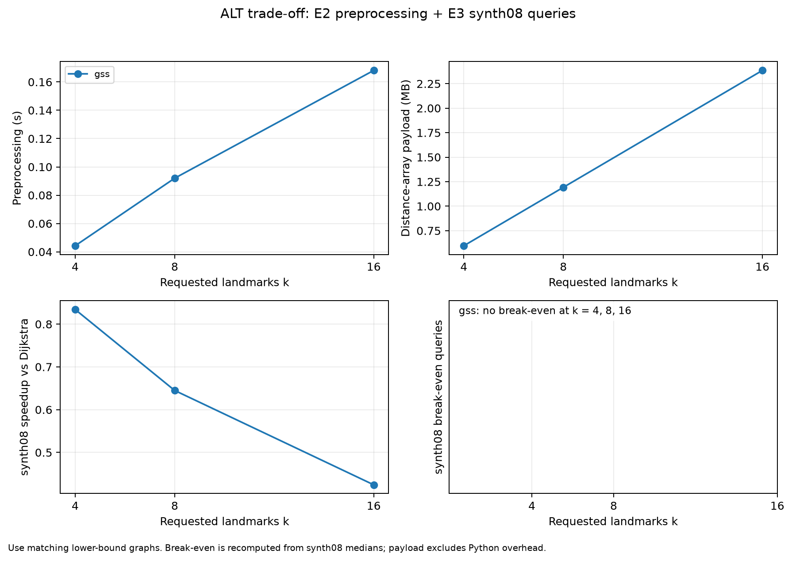

# 서울 최단경로: 같은 답을 더 싸게 구하기

DCCS309 Algorithms · Team C2 (권세현 · 김태형 · 정의종)

서울 도로망에서 Dijkstra, A\*, Bidirectional Dijkstra, ALT가 **같은 최단경로를 얼마나 싸게 구하는지** 비교한 프로젝트다. 모든 기법은 Dijkstra와 거리가 일치하는지 먼저 검사하고, 통과한 뒤에만 시간을 쟀다.

> 이 README는 초안이다. 문제·데이터는 권세현, 알고리즘은 김태형, 결과·향후는 정의종이 각자 확인하고 고친다.

## 1. 문제와 연구 질문 (권세현)

도로 경로 서비스는 같은 도로망에서 질의를 계속 받는다. 정확한 답은 그대로 두고 질의 한 번의 비용(시간, 탐색한 정점 수)을 줄이는 방법을 비교한다.

| 질문 | 내용 |
|---|---|
| RQ1 (자유류) | A\*, Bidirectional, ALT는 Dijkstra 대비 질의 시간과 탐색량을 얼마나 줄이나? 그래프 규모, 출발–도착 거리, 랜드마크 수에 따라 어떻게 달라지나? |
| RQ2 (혼잡) | 간선 이동시간이 늘어도 재전처리 없이 정확한가? 가속 효과는 얼마나 남나? |
| RQ3 (재탐색) | 교통이 바뀌었을 때 경로를 다시 구하면 통행시간이 얼마나 줄어드나? |

**범위 변경:** RQ3는 원래 SUMO 교통 시뮬레이션(E4)으로 답하려 했으나 11/3에 연기했다. 대신 차량 1대가 합성 혼잡 스냅샷에서 경로를 다시 구하면 얼마나 줄어드는지만 본다. 재탐색 차량 비율에 따른 효과는 아직 답하지 못했다.

**정확성 기준:** 거리 상대 오차 1e-9 이하, 경로가 실제로 이어지는 유효한 경로일 것. 관문 스크립트가 강남구, 3개 구, 서울에서 모두 `ALL EXACT`를 냈다.

### 데이터

| 그래프 | 정점 n | 간선 m | vmax (km/h) | maxspeed 결측 |
|---|---|---|---|---|
| 강남구 (gangnam) | 3,144 | 8,420 | 80 | 93.8% |
| 강남·서초·송파 (gss) | 9,317 | 25,435 | 110 | 95.8% |
| 서울 전체 (seoul) | 67,420 | 185,415 | 110 | 95.8% |



- 도로망은 OpenStreetMap에서 OSMnx로 뽑았다. 방향 그래프이고, 간선 가중치는 이동시간(길이 ÷ 속도)이다.
- **속도 결측:** OSM `maxspeed`가 94~96% 비어 있다. 비어 있는 간선은 실측 속도가 아니라 **도로 등급별 대표 속도**로 채웠다. 그러므로 가중치는 "현실의 실제 통행시간"이 아니라 등급 기반 추정이다.
- 같은 (u, v) 간선은 하나만 두고, vmax는 그래프에서 한 번 계산해 A\*의 하한에 쓴다.

### 실제 속도 데이터는 쓰지 못했다

- 국가교통정보센터(ITS) 교통소통정보 API를 5분 간격으로 수집했다(2026-10-31 ~ 11-03, 스냅샷 142개, 첫 스냅샷의 링크 7,441개).
- 11/3 03:21 KST에 API 월 호출 한도(resultCode 4001)로 수집이 끝났고, 출근 시간(08시) 스냅샷이 없어 **혼잡 실험에는 쓰지 않기로 결정(REJECT)** 했다.
- 그래서 E3의 혼잡은 합성 시나리오(도로 등급별 배율, 무작위 간선, 대조군)로 만들었다. 자세한 경위는 `results/match_decision.md`, 수집 범위는 `results/coverage_day1.txt`.

### 데이터 출처 (Data Sources)

이 프로젝트는 아래 공공데이터를 사용한 결과물입니다.

- **국가교통정보센터 (ITS) 교통소통정보 API**
  - 출처: 국토교통부 국가교통정보센터, https://www.its.go.kr/opendata
  - 용도: 도로 구간별 통행속도를 5분 간격으로 수집해 혼잡 시 간선 이동시간 가중치로 사용하려 했다. 위 이유로 최종 실험에는 쓰지 않았다.

- **서울특별시 실시간 도로 소통 정보 (서울 열린데이터광장)**
  - 본 프로젝트는 **서울특별시 공공데이터**를 사용한 결과입니다.
  - 출처: 서울 열린데이터광장, https://data.seoul.go.kr/dataList/OA-13291/A/1/datasetView.do
  - 용도: ITS 데이터의 백업 및 서울 구간 속도 보완

- **OpenStreetMap 도로망**
  - © OpenStreetMap contributors, ODbL 라이선스 (https://www.openstreetmap.org/copyright)
  - 용도: OSMnx로 서울 자동차 도로망 그래프 구성

모든 데이터는 대학교 알고리즘 수업 과제의 비상업적 학습 목적으로만 사용합니다.
수집한 원본 데이터와 API 인증키는 저장소에 포함하지 않습니다.

## 2. 알고리즘과 실험 설계 (김태형)

| 기법 | 한 줄 설명 | 전처리 |
|---|---|---|
| 완전탐색 | 모든 단순 경로를 훑어 가장 짧은 것을 고른다. 비교의 바닥 기준 | 없음 |
| Dijkstra | 확정한 정점은 다시 보지 않는다. 기준 알고리즘 | 없음 |
| A\* | 직선거리 ÷ vmax를 하한으로 써서 목적지 쪽을 먼저 본다 | 없음 |
| Bidirectional | 출발·도착 양쪽에서 탐색하되, 큐 최솟값이 작은 쪽을 넓힌다. 처음 만났다고 멈추지 않고, 두 큐의 최솟값 합이 지금까지 찾은 최단 만남 거리 μ 이상이 되면 멈춘다 | 없음 |
| ALT | 랜드마크까지 거리와 삼각부등식으로 만든 하한을 A\*에 쓴다 (k = 4, 8, 16) | 랜드마크 거리 계산 |

| 실험 | 그래프 | 무엇을 보나 |
|---|---|---|
| E1 | 강남구 BFS 부분 그래프 | 완전탐색이 언제 포기하게 되나 |
| E2 | 강남 → 3개 구 → 서울 | 거리 구간(<3 km, 3–10 km, >10 km)별 가속비, 하한의 촘촘함 |
| E3 | 3개 구, 서울 | 혼잡 시나리오에서 정확성과 가속비, ALT 트레이드오프 |
| 재탐색 효과 | 3개 구, 서울 | 차량 1대가 혼잡 스냅샷에서 경로를 다시 구했을 때 줄어드는 통행시간 |

- 질의는 그래프마다 300개(거리 구간별 100개), 시드 42. 질의 집합은 `osm_id`로 저장한다.
- 시간은 워밍업을 별도로 돌린 뒤 중앙값과 p95로 보고한다. 머신과 무관한 주 지표는 **확정한 정점 수**다.
- 최종 결과는 한 대의 머신에서 `scripts/run_all.sh`로 한 번에 돌려 동결했다(태그 `results-frozen`).

## 3. 결과와 향후 (정의종)

### E1. 완전탐색은 금방 한계에 닿는다

- 강남구 부분 그래프에서 정점 90개가 되자 10초 제한을 넘기는 질의가 나왔다(그 크기의 질의 20개 중 4개).
- 격자 그래프의 코너 간 단순 경로 수는 12(3×3), 184(4×4), 8,512(5×5), 1,262,816(6×6)으로 빠르게 늘어난다.



### E2 (RQ1). ALT가 가장 많이 줄인다

서울 그래프, 거리 구간 >10 km 기준:

| 기법 | 가속비 | 확정 정점 비율 |
|---|---|---|
| ALT k = 16 | 4.89× | 0.045 |
| ALT k = 8 | 4.39× | 0.075 |
| Bidirectional | 1.21× | 0.572 |
| A\* | 1.10× | 0.603 |

- 거리 구간과 k에 따라 ALT는 서울에서 2.4~5.4배 빨랐다.
- 작은 그래프의 장거리 질의에서는 A\*가 Dijkstra보다 **느리다**(강남·gss >10 km에서 0.69×). 확정 정점은 거의 줄지 않는데 정점마다 하한 계산 비용이 붙기 때문으로 해석한다.
- A\*의 하한은 실제 거리의 0.37~0.49 수준이고 ALT는 0.81~0.93이다. 최고 속도(vmax)가 커서 이동시간 가중치에서 직선거리 하한이 느슨해진다.
- ALT는 공짜가 아니다. 서울 k = 16은 전처리 1.59 s, 거리 배열 17.3 MB이고 약 133개 질의를 처리하면 본전이다.




### E3 (RQ2). 혼잡에서도 정확하다, 단 하한이 깨지면 틀린다

- 간선 이동시간이 **늘어나는** 시나리오(등급별 배율, 무작위 30%)에서는 A\*, Bidirectional, ALT 모두 재전처리 없이 Dijkstra와 일치했다.
- 대조군은 일부 간선 속도를 **올려서** 하한을 깨뜨린다. 그러면 서울에서 A\*는 300개 중 16개, ALT는 155~174개가 틀렸다. 하한이 실제 거리를 넘으면 정확성이 깨진다는 것을 보여 준다.




### RQ3. 경로를 다시 구하면 얼마나 줄어드나 (좁힌 범위)

- 합성 혼잡 스냅샷에서 출발 시점부터 새 경로를 쓰면 서울에서 통행시간이 **중앙값 약 2.5%** 줄었다(300개 중 273개가 개선, 시나리오 synth08).
- 이동 중간에 다시 구한 경우는 개선 폭이 더 작다.
- SUMO 교통 시뮬레이션과 재탐색 차량 비율 실험은 하지 못했다.

### 한계와 향후

- 속도가 실제 통행시간이 아니라 등급 평균 추정이다. 실제 속도를 쓰려면 월 호출 한도 안에서 수집 계획을 다시 세워야 한다.
- 회전 제한, 신호, 시간 의존 최단경로는 다루지 않았다.
- CH, CRP 같은 더 강한 전처리 기법은 구현하지 않았다. 공개 엔진과 문헌 비교는 `docs/industry.md`에 정리했다.
- 재탐색 보급률과 사용자 최적·시스템 최적의 차이(공정성)는 후속 실험 제안이다.

## 4. 실행 방법

```bash
# 맥
/opt/homebrew/bin/python3.14 -m venv .venv && source .venv/bin/activate && pip install -e .
# 윈도우: Python 3.10 이상, 코어만 쓰면 pip install -e . --no-deps

pytest                                             # 전체 테스트
python scripts/check_exact.py data/graphs/gangnam_graph_v1.pkl data/queries/gangnam_q_seed42.csv   # 정확성 관문
bash scripts/run_all.sh --dry-run                  # 최종 실행 명령만 출력
```

그래프 파일(`data/graphs/*.pkl`)은 git에 올리지 않고 공유 드라이브로 나눈다. 코어 모듈은 표준 라이브러리만 쓴다.

## 5. 저장소 안내

- `src/routing/`: 그래프, 알고리즘, 실험
- `results/`: 동결 결과(CSV, 경위 문서). `figures/`: 그림
- `docs/explain/`: 알고리즘별 본인 설명, `docs/industry.md`: 현업·문헌 조사, `docs/ai-usage.md`: 생성형 AI 사용 기록
- 팀 실행 계획: `seoul_routing_plan_v2.md`, 구현 계획: `docs/superpowers/plans/`

생성형 AI(Claude Code)를 사용했고 사용 내역은 `docs/ai-usage.md`에 기록했다.
