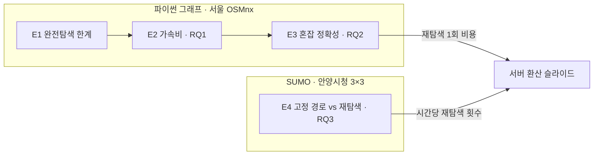

# 서울 최단경로 팀프로젝트 통합 실행 계획 v2

| 항목 | 내용 |
|---|---|
| 작성일 | 2026-10-30 |
| 과목 | DCCS309 Algorithms (조병진 교수님) · Team C2 |
| 팀원 | 권세현 · 김태형 · 정의종 |
| 기준 자료 | 인수인계 문서(10/29), 노션 "알고리즘 팀플", 안양 SUMO 작업순서 9~23 문서 |
| v1 대비 바뀐 점 | 안양 SUMO 재탐색 데모(E4) 추가, 제출 마감 시각 확인, 공용 구현 규칙·Q&A 대비 추가 |

> 노션 "11일 계획"은 교수님 피드백 전 버전입니다(재탐색 "빼기", 혼잡 무작위 4개). 이 문서가 최신입니다.

---

## 0. 한눈에 보기

- **마감**
  - 11/9(월) **17:59**: 발표 영상 + 슬라이드 제출 (팀 목표는 오전 제출)
  - 11/20(금): 발표 + Live Q&A
  - 12/14: GitHub README 포트폴리오, 강의 성찰
- **방향**: 정적 알고리즘을 동적으로 쓰기 (교수님 피드백, 10/29)
- **구조 (2층)**
  - 알고리즘 비교 = 서울 OSMnx 파이썬 그래프 → "같은 경로를 얼마나 싸게 구하나"
  - 재탐색 데모 = 안양시청 3×3 SUMO → "재탐색이 통행시간을 얼마나 줄이나"
- **절대 줄이지 않는 것**: 모든 기법 = Dijkstra 100% 일치 검사. 시간 측정은 이 검사를 통과한 뒤에만
- **오늘(10/30) 꼭 할 3가지**
  1. 실시간 속도 수집 스크립트 가동 + API 인증키 신청 (세현)
  2. 공용 규칙 확정: vmax 계산 방식, 탐색 카운터 정의, 그래프 파일 버전 (전원, 4장)
  3. 안양 망에 `check_sumo_env.py --run` 실행 (태형, 연구실 PC)

---

## 1. 결정 사항

| 항목 | 결정 | 이유 |
|---|---|---|
| 도구 | OSMnx(알고리즘 비교) + SUMO(재탐색 데모)로 역할 분리 | 정확한 알고리즘은 모두 같은 경로를 내므로 SUMO 교통 KPI는 알고리즘 간에 같음. 알고리즘 차이는 큰 그래프에서만 보임 |
| 알고리즘 비교 지역 | 서울: 강남구 → 강남·서초·송파 → 서울 전체 | 파트 3("입력이 커질 때")에 규모 사다리가 필요. 교수님이 서울 공개 데이터를 언급 |
| SUMO 데모 지역 | 안양시청 3×3 (기존 연구 환경) | 3가지 조건 충족(부록 A). 45회 구동 Error 0, 이미 TraCI로 구동. 서울 SUMO를 새로 만들면 2~3일 |
| 오픈소스 시나리오 | 쓰지 않음 | 안양이 조건 충족. 안양이 막히면 Bologna(Acosta)로 대체 |
| SUMO 신호 | W(Webster)가 기본, A·B는 민감도 확인용 | 실제 신호 시간은 비공개. 표준 공식 + 여러 안에서 같은 경향인지 확인 |
| 범위 밖 | 파이썬 쪽 회전 제한, CH·CRP, 시간의존(FIFO) 최단경로, 실제 신호 현시 | 11일 안에 무리 → 향후 과제 슬라이드 1장. 회전 제한·신호는 SUMO 쪽에서 반영됨 |

---

## 2. 연구 질문

- **RQ1 (자유류)**: A*, Bidirectional, ALT는 Dijkstra 대비 질의 시간과 탐색량을 얼마나 줄이나? 그래프 규모, s–t 거리, 랜드마크 수에 따라 어떻게 달라지나?
- **RQ2 (혼잡)**: 간선 이동시간이 늘어도 재전처리 없이 정확한가? 가속 효과는 얼마나 남나?
- **RQ3 (재탐색, 신규)**: 교통이 바뀔 때 주기적 재탐색은 고정 경로 대비 평균·p95 통행시간을 얼마나 줄이나? 재탐색하는 차량 비율(보급률)에 따라 어떻게 달라지나?

---

## 3. 실험 설계

| 실험 | 그래프 | 비교 | 산출 | 담당 |
|---|---|---|---|---|
| E1 | 강남구 BFS 부분 그래프 | 완전탐색 vs Dijkstra | 일치 확인 + 포기 지점, 그림 (a) | 세현 |
| E2 | 강남 → 3개 구 → 서울 | Dijkstra, A*, Bidirectional, ALT | 거리 구간별 가속비, 그림 (b) | 태형 |
| E3 | 3개 구 (+ 서울) | 같은 4개 기법 | 혼잡 시나리오별 정확성·가속비, ALT 트레이드오프, 그림 (c)(d) | 의종 |
| E4 | 안양 SUMO | 고정 경로 vs 재탐색 | 통행시간 KPI, 그림 (e) | 태형(환경·실행) + 의종(재탐색 함수) (안) |

### E1. 완전탐색 한계

- n = 10, 12, 14, … 로 촘촘히 키움. 크기별 질의 20개, 10초 제한
- 도로망은 차수가 낮아 n = 20에서도 안 터질 수 있음 → n을 미리 고정하지 말고 10초를 넘을 때까지 키움
- BFS 부분 그래프도 SCC로 다시 잘라야 s–t 도달이 보장됨
- 보조 슬라이드: n×n 격자에서 대각 모서리를 잇는 단순 경로 수
  - 4×4: 184 → 5×5: 8,512 → 6×6: 약 126만 → 7×7: 약 5.8억 (OEIS A007764)

### E2. 가속비 (RQ1)

- 거리 구간 <3 km, 3–10 km, >10 km, 구간별 질의 100개, 고정 시드
- 질의 집합은 `osm_id`로 저장 (그래프를 다시 뽑으면 정수 번호가 바뀜)
- ALT k = 4, 8, 16: 전처리 시간, 인덱스 크기, 손익분기 질의 수
- 측정: 시간 중앙값·p95, 확정 정점, 완화 간선, 힙 push/pop

### E3. 혼잡 정확성 (RQ2)

| 시나리오 | 내용 |
|---|---|
| 실제 속도 3개 | 새벽 3시 · 출근 8시 · 퇴근 18시 스냅샷 (링크 매칭 성공 시) |
| 합성 (기본) | 도로 등급별 배율 ≥ 1 (매칭 실패 시 실제 속도 3개를 대체) |
| 무작위 1개 | 간선 30%에 ×2 |
| 대조군 1개 | 일부 간선 속도를 올림 → A*·ALT 하한이 깨지는 것을 보여줌 |

- 재탐색 1회 비용: 현재 위치 → 목적지 재질의의 시간·탐색량 (ALT는 랜드마크 값 재사용)
- 서버 환산 슬라이드: "차량 1만 대를 10초 안에 재탐색하려면 서버가 몇 대?" → Dijkstra 대비 **비율**로 제시 (Python 절대값으로 서버 대수를 단정하지 않음)
- 선택: Weighted A* (h × ε, ε = 1.2, 1.5) → 빠르지만 최대 ε배 손해. 속도 vs 최적성 트레이드오프 (A* 코드 한 줄)

### E4. 안양 SUMO 재탐색 데모 (RQ3)

| 항목 | 설정 |
|---|---|
| 전략 | ① 고정 경로: 현재 방식(OD 90쌍별 자유류 최단 1개) ② 재탐색: 60초마다 현재 간선 통과시간으로 Dijkstra 재질의 |
| 보급률 | 100% (기본), 30% (선택: 우회로 몰림 확인, 내비 사용자 비율 관점) |
| 수요 | Medium(1.0) 주력, 1.25 (수요 파일 새로 생성), High(1.5)는 보너스 |
| 신호 | W 기본. A·B는 Medium에서만 민감도 확인 |
| 시드 | 3개 (기존 1~3) |
| KPI | 기존 KPI 재사용: 예정 출발 기준 평균·p95 통행시간, 처리량, 망 멈춤 시각, 시민대로 OD(B0W↔B3E) 통행시간 |
| 실행 수 | 기본 2 전략 × 2 수요 × 3 시드 = 12회 + 민감도(A·B) 2 × 2 × 3 = 12회 (+ 보급률 30% 3회) ≈ 27회 |

- **그래프**: sumolib으로 "SUMO 간선 = 정점, connection = 간선" 그래프 생성
  - connection 332개(회전 제한 포함)가 그대로 반영되고, 접근부 간선(`_ap`)도 자동으로 이어짐
  - 같은 공용 형식(fwd/bwd)으로 변환해 `dijkstra.py`를 그대로 재사용
- **가중치**: `traci.edge.getTraveltime` 값을 60초 단위로 평활 (신호 대기 포함)
- **경로 변경**: 차량이 새 간선에 진입한 직후에만 `traci.vehicle.setRoute`
  - 교차로 직전에 바꾸면 회전 차로로 못 들어가 멈출 수 있음
- **기록**: 시간당 재탐색 횟수 → E3의 재탐색 1회 비용과 곱해 서버 환산 슬라이드에 연결
- **High 주의**: 망 전체가 멈추면 우회로도 막혀 재탐색 효과가 묻힘 → Medium·1.25가 주력

---

## 4. 공용 구현 규칙 (오늘 확정)

### 4-1. 형식

- 정점: 0..n−1 정수. 간선: 정방향·역방향 인접 배열 `(이웃, 이동시간 초 float)`
- `coords[i] = (위도, 경도)`, `osm_ids[i]` 함께 저장. 평행 간선은 가장 빠른 것만
- 함수 모양: `shortest_path(g, s, t)` → `(거리, 경로, 확정 노드 수)`
- 그래프 파일명에 버전 표기 (예: `gangnam_graph_v1.pkl`). 다시 추출하면 버전을 올리고 팀에 공지

### 4-2. 정확성 함정

| 항목 | 규칙 |
|---|---|
| vmax (A* 휴리스틱) | 합의값이 아니라 그래프에서 계산: `max(length / travel_time)`. 혼잡은 느려지기만 하므로 계속 유효 |
| A* 휴리스틱 | `h × (1 − 1e-9)`: haversine과 OSMnx length의 미세한 계산 차이로 1e-9 검사에서 실패하는 것 방지 |
| A* vs ALT 조건 | A*는 "모든 간선 속도 ≤ vmax"만 필요. "ℓ' ≥ ℓ0"(자유류보다 느려지기만 함)은 ALT에만 필요 → 관측 속도 자르기는 ALT 기준값에만 적용 |
| Bidirectional 종료 | `top_f + top_b ≥ μ` (처음 만났을 때 멈추면 틀림). 역방향 탐색은 `bwd` 배열 사용 |
| 탐색 카운터 | heapq lazy deletion에서 오래된 항목 pop은 "확정"에서 제외. Bidirectional은 양쪽 합산. 공용 힙에서 정의 고정 |
| 정확성 검사 | 거리 비교(상대 오차 1e-9) + 경로 유효성. 경로 동일성은 비교하지 않음 (동점 경로 존재) |

### 4-3. 측정

- 최종 벤치마크는 **한 머신에서 한 번에** (각자 노트북 결과는 비교 불가)
- 워밍업, `gc.disable()`, `time.perf_counter`, 중앙값·p95
- PR 전 `tests/test_correctness.py` 실행

---

## 5. 데이터 계획

| 데이터 | 출처 | 할 일 | 대체안 |
|---|---|---|---|
| 도로망 | OSMnx `network_type="drive"` | 세현이 추출·공유, 팀원은 재다운로드 금지. maxspeed 결측 비율 기록 | 표준노드링크 |
| 과거 링크 속도 | TOPIS 링크별 통행속도 | 형식 확인 (보통 1시간 단위 → 시간대 스냅샷용) | 도로 등급별 비율 |
| 실시간 링크 속도 | 서울 열린데이터광장 실시간 도로 소통 정보 / ITS 국가교통정보센터 소통정보 | **오늘부터** 5분 간격 수집 (강남·서초·송파 범위). 인증키 승인 지연 대비해 오늘 신청 | 과거 1시간 데이터만 사용 |
| 표준노드링크 SHP | ITS 국가교통정보센터 | 한국 TM 좌표계 → WGS84 변환 후 OSM 간선과 좌표·방향 매칭 | 도로 등급 × 시간대 평균 비율 |
| 안양 수요 | 작업순서 14·20 (가정 시나리오) | 발표에서 "가정 수요"라고 명시 | — |

- 서울 속도 데이터는 간선도로·도시고속도로 위주 → 이면도로는 관측값과 도로 등급 비율을 섞음. 섞은 비율을 보고
- 서울시 차량통행속도 보고서(OA-12872)는 종료된 서비스
- **결정 기한 11/2**: 링크 매칭이 안 되면 합성 혼잡으로 확정

---

## 6. 역할

| 팀원 | 구현 | 실험·그림 | 리뷰 | 영상 파트 |
|---|---|---|---|---|
| 권세현 | 데이터 파이프라인, 완전탐색, 정확성 검사 도구, 속도 데이터 수집·매칭 | E1, 그림 (a) | ALT | 문제·데이터·완전탐색 |
| 김태형 | 공용 힙 + 카운터, Dijkstra, A*, Bidirectional, 질의 생성, SUMO 환경·TraCI 연동 | E2 그림 (b), E4 실행 | 파이프라인·완전탐색 | Dijkstra 계열·가속비 |
| 정의종 | ALT, 혼잡 가중치, 재탐색 함수 (E3·E4 공용) | E3 그림 (c)(d), E4 그림 (e) | Dijkstra 계열 | ALT·혼잡·재탐색·결론 |

- 한 사람이 늦어지면 리뷰 담당이 이어받음 (세현 → ALT, 태형 → 파이프라인, 의종 → Dijkstra 계열)
- E4가 더해져 태형 부담이 큼 → 10장 열린 결정에서 재조정

---

## 7. 일정 (10/30 기준)

| 날짜 | 권세현 | 김태형 | 정의종 | 관문 |
|---|---|---|---|---|
| 10/30 금 | 3개 구·서울 추출, 속도 보정 비율 기록, 속도 데이터 확인, 인증키 신청 + 수집 시작 | Dijkstra NetworkX 대조, A*, 안양 `check_sumo_env.py --run` | 랜드마크 선택 + 정·역방향 전처리 | 공용 규칙 확정 (4장) |
| 10/31 토 | 완전탐색 + BFS 부분 그래프, 정확성 검사 도구 | Bidirectional, sumolib 간선 그래프 + setRoute 1대 테스트 | ALT 질의, 합성 혼잡 가중치 함수 | |
| 11/1 일 | E1 실행 | 자기 코드 검증 | 자기 코드 검증, 재탐색 함수 공용화 | **강남구에서 전 기법 = Dijkstra 100%** |
| 11/2 월 | 그림 (a), ALT 리뷰, 링크 매칭 결과 공유 | 고정 시드 질의 집합, 시간 측정 도구, SUMO 재탐색 Medium 1회 | k = 4, 8, 16 전처리(3개 구), 시간대 가중치 | **실제 속도 채택 여부 · SUMO 재탐색 1회 동작 여부** |
| 11/3 화 | 서울 전체 정확성 검사 | E2 밤새 실행, E4 본 실행(연구실 PC, 약 27회) | 서울 전체 ALT 전처리 | **서울 전체에서 전 기법 = Dijkstra 100%** |
| 11/4 수 | 데이터 설명 자료 (지도, 그래프 크기) | 그림 (b) | E3 + 재탐색 비용, 그림 (c)(d)(e) | |
| 11/5 목 | 슬라이드 구성안 + 영어 대본 | 동일 | 동일 | **결과 동결** |
| 11/6 금 | 슬라이드 완성 | 슬라이드 완성 | 슬라이드 완성 + 통합 | |
| 11/7 토 | 자기 파트 녹화 | 녹화 | 녹화 | |
| 11/8 일 | 편집본 검토, 수치 대조 | 영상 편집 | 수치 대조 | 팀 전체 시청 + 수정 |
| 11/9 월 | | | | **오전 제출 목표 (마감 17:59)** |
| 11/10–19 | README 문제·데이터 | README 알고리즘 | README 결과·향후 | 예상 질문 목록 + 리허설 2회 |
| 11/20 금 | | | | **발표 + Live Q&A** |
| ~12/14 | | | | 포트폴리오 README 완성, 강의 성찰 |

- 10/29 항목(강남구 그래프, 공용 힙, ALT 설계)이 끝났는지 오늘 먼저 확인
- 영어 대본 시간(11/5–6)은 줄이지 않음

### 우선순위 (밀리면 아래부터 포기)

1. E1 · E2 (정적 비교)
2. E3 합성 혼잡 + 재탐색 비용
3. E4 안양 재탐색 데모
4. E3를 실제 속도 데이터로 교체

---

## 8. 발표 구성 (15분, 영어, 4개 파트 필수)

| 파트 | 시간 | 내용 | 근거 | 담당 |
|---|---|---|---|---|
| 1. 문제 정의 | 약 3분 | 길찾기가 왜 중요하고 왜 어려운가 (도로망 규모, 교통이 계속 바뀜). 완전탐색 폭발 | E1, 격자 경로 수 | 세현 |
| 2. 현업 해결 방식 | 약 3분 | 배달·내비 플랫폼은 교통이 바뀔 때마다 수천 대를 재탐색 → 속도·비용 최적화. CH(OSRM·GraphHopper), CRP(Bing Maps), Landmark = ALT(GraphHopper) | 공개 문헌 | **미정** |
| 3. 소규모 데모 | 약 6분 | 가속비, 혼잡 정확성·ALT 트레이드오프, 안양 재탐색 | E2, E3, E4 | 태형 · 의종 |
| 4. 결론·전망 | 약 2분 | 배운 점, 산업 결과와 일치 여부, 한계(Python, 가정 수요·신호), 향후(CH, 실제 신호, 시간의존) | 전체 | 의종 |

- 국내 기업(쿠팡이츠, 배민, Tmap, 카카오)은 라우팅 알고리즘을 공개하지 않음 → "X사가 Y를 쓴다"고 단정하지 않음
- 생성형 AI 사용은 출처 표기. 레퍼런스는 원문을 직접 확인한 것만 (부록 C)

---

## 9. Q&A 대비

| 예상 질문 | 답 요지 |
|---|---|
| 모든 알고리즘이 같은 경로를 내면 왜 비교하나? | 결과는 같고 비용이 다름. 재탐색이 잦은 서비스에서는 1회 비용이 서버 비용으로 직결 |
| A*가 생각보다 안 빠른 이유는? | 이동시간 가중치에서 하한 = 직선거리 ÷ 최고속도가 느슨함 (고속 구간 때문에 vmax가 큼) |
| 혼잡하면 왜 재전처리 없이도 정확한가? | 간선이 느려지기만 하면(ℓ' ≥ ℓ0) 자유류 기준 하한이 그대로 유효. 대조군처럼 빨라지면 깨짐 |
| Bidirectional은 언제 멈추나? | `top_f + top_b ≥ μ`. 처음 만났을 때 멈추면 틀린 답 |
| 신호가 실제 신호가 아닌데? | 실제 신호 데이터는 비공개. 표준 Webster 안을 기본으로, 3개 안 모두에서 같은 경향인지 확인 (결과가 그렇게 나왔을 때만 이 답 사용) |
| 수요가 가정인데 결과를 믿을 수 있나? | 도로는 거리뷰·위성 실측(차로 수 가정 0개), 수요는 시나리오. 같은 조건에서 전략 간 상대 비교 |
| Python 측정으로 서버 대수를 말해도 되나? | 절대값이 아니라 Dijkstra 대비 비율로만 제시 |
| 모두 재탐색하면 같은 우회로로 몰리지 않나? | 보급률 30% vs 100% 비교로 확인 (사용자 최적 vs 시스템 최적) |

---

## 10. 위험과 대비책

| 위험 | 대비책 |
|---|---|
| 범위 과다 | 7장 우선순위대로 포기. 관문 실패 시 시간 측정 중단, 버그부터 |
| 세현 그래프 파일 지연 | 태형·의종은 손으로 만든 10노드 그래프로 먼저 시작 |
| 서울 전체에서 Python이 느림 | 구간별 100개, 밤새 실행. 안 되면 3개 구가 최대 규모, 발표에서 밝힘 |
| OSMnx 다운로드 실패·버전 차이 | 세현 파일 공유. 예전 버전은 `ox.utils_graph.get_largest_component` |
| 링크 매칭 실패 | 11/2에 합성 혼잡으로 확정 |
| SUMO 재탐색이 11/2까지 안 돎 | E4를 "차량 1대 경로 변경 시각화"로 축소하거나 제외 |
| 재탐색 몰림 / High 망 멈춤 | 보급률 조절, 갱신 주기 조절, Medium·1.25 주력 |
| 측정 머신 차이 | 최종 벤치마크는 한 머신 |
| 녹화·편집 지연 | 11/8을 여유일로, 11/9엔 제출만 |
| 안양 환경은 연구실 연구용 | 수업 사용 가능 여부, 레포 공유 범위 사전 확인. 연구실 다음 액션 아이템("경로 분산")과 겹치는 부분 조율 |

---

## 11. 열린 결정 사항

- [ ] E4 담당 확정 (안: 태형 환경·실행 + 의종 재탐색 함수). 태형 부담 재조정 필요 여부
- [ ] 발표 파트 2(현업 해결 방식) 담당
- [ ] 실제 속도 데이터 채택 여부 (11/2)
- [ ] 안양 SUMO 환경 수업 사용 승인 (연구실)
- [ ] 공용 규칙 4장 합의 (vmax 계산 방식, 카운터 정의, 파일 버전)
- [ ] GitHub 레포 `seoul-routing` 생성 + 팀원 초대
- [ ] LMS에서 영상 길이 제한 확인
- [ ] 노션 "11일 계획"을 이 문서 기준으로 갱신
- [x] 제출 마감 시각: 11/9 17:59 (노션 과제 일정에서 확인)

---

## 부록 A. 안양 SUMO 환경 요약과 판정

### 환경 (작업순서 9~23)

| 항목 | 값 |
|---|---|
| 범위 | 안양시청 주변 3×3 블록, 주요 교차로 16개(4×4 격자), 메인도로 14개 노선 |
| 망 | Node 50, Edge 92, Connection 332 (회전 제한: C0 남행 좌회전 금지, U턴 금지 2곳) |
| 도로 근거 | 거리뷰·위성 판독. 차로 수 가정값 0개, 접근부 배분 31개 방향·제한속도 10개 방향은 가정 |
| 경계 | 진입·이탈 10곳, OD 90쌍 (같은 축 반대편 직진 가중치 4) |
| 수요 | 2시간 이항분포 B(7, 0.5). Low 5,113 / Medium 6,822 / High 10,236대 (가정 시나리오) |
| 신호 | W Webster(고정식), A 대기 차량 비교(TraCI 감응식), B 옵셋 연동(주기 160초) |
| 구동 | `run_sim.py` TraCI 구동, 45회 Error 0 · Teleport 0. Medium 1회 약 40초 |
| 기존 결과 | Low·Medium: A가 평균 통행시간 −12~15%. High: 세 안 모두 망 멈춤. 병목 B2·B1·C1 |
| 기존 한계 | 경로 고정(OD별 1개) → 다음 액션 아이템에 "경로 분산 후 High 재비교" |

### 판정

| 조건 | 판정 | 근거 |
|---|---|---|
| 우회 경로 | OK (조건부) | 아래 근사 계산 참고. 같은 축 직진 통과 OD는 대안이 멀다 |
| 정체 | OK | Medium = 용량 한계, High = 과포화. 병목이 시민대로 축에 몰려 간선별 지체 편차가 큼 |
| TraCI | OK | 이미 TraCI로 구동 중. `setRoute` 추가만 남음 |

### 우회 경로 근사 계산

문서의 교차로 좌표·제한속도·회전 제한으로 재구성한 근사 그래프입니다. 신호 대기는 빠져 있습니다.

| 기준 | OD 90쌍 | 차량 수 가중 |
|---|---|---|
| 자유류 최단의 1.2배 이내 대안 2개 이상 | 61% | 45% |
| 1.5배 이내 대안 2개 이상 | 84% | 75% |

- 같은 축 반대편 직진 통과 OD가 차량의 35%. 이들은 2등 경로가 1.5~1.7배
- 시민대로 통과(B0W↔B3E)는 C행 우회가 1.21배 → 병목 B1·B2와 겹쳐 데모에 가장 좋은 OD
- 실제 망 확인: `python3 check_sumo_env.py <anyang.sumocfg> --run` (회전 연결 반영 대안 수, 실제 지체, setRoute 테스트)

---

## 부록 B. 혼잡 정확성 논리 (발표용 한 줄 정리)

- 자유류 이동시간 ℓ0로 한 번 전처리 → 혼잡 후 ℓ' ≥ ℓ0이면 하한이 그대로 유효 → 정확 (하한이 느슨해져 느려질 뿐)
- ALT 일관성: h(u) − h(v) ≤ ℓ0(u, v) ≤ ℓ'(u, v)
- 간선이 빨라지면(ℓ' < ℓ0) 보장이 깨짐 → 대조군으로 시연
- 실제 속도가 자유류보다 빠른 구간 → ALT 기준값을 "관측 최고 속도"로 잡거나 관측값을 자유류 이하로 자름

---

## 부록 C. 참고 자료

### 팀 자료

- 노션 알고리즘 팀플: https://app.notion.com/p/3d1a9c47121e8023bf8ec3859f72968a
- 온라인 계획 문서(v1): https://claude.ai/artifact/CMAtYXcUYnXJtCD4ybVW3c
- 안양 SUMO 작업순서 2~23 문서 (태형 SUMO 프로젝트)

### 데이터·도구

- 서울시 차량통행속도 보고서 OA-12872 (종료): https://data.seoul.go.kr/dataList/OA-12872/L/1/datasetView.do
- SUMO 공개 시나리오 목록: https://sumo.dlr.de/docs/Data/Scenarios.html
- SUMO 신호 Webster 도구: `$SUMO_HOME/tools/tlsCycleAdaptation.py`

### 산업·문헌 레퍼런스 후보 (인용 전 원문 확인)

- Bast et al., *Route Planning in Transportation Networks* (2016): 경로 탐색 기법 서베이
- Goldberg & Harrelson, *Computing the Shortest Path: A\* Search Meets Graph Theory* (SODA 2005): ALT 원 논문
- Geisberger et al., *Contraction Hierarchies* (WEA 2008)
- Delling et al., *Customizable Route Planning* (SEA 2011): Bing Maps
- OSRM, GraphHopper 공식 문서 (CH, Landmark 모드)
